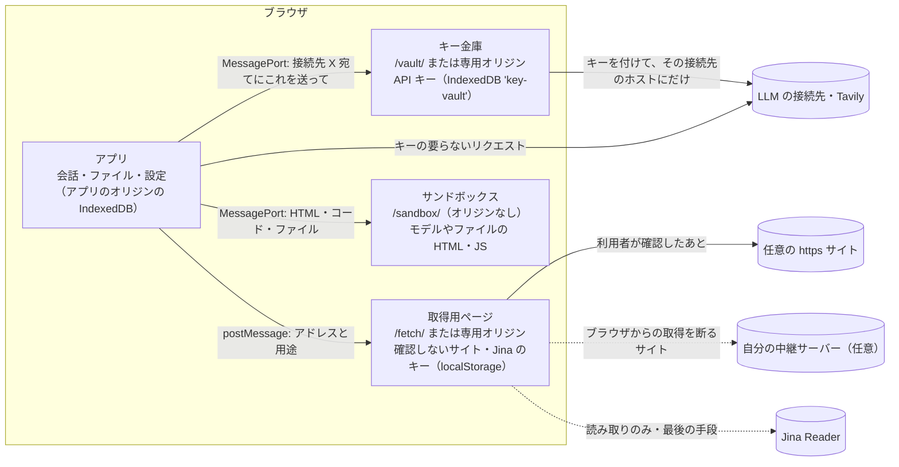

# セキュリティ

[English](security.md) | **日本語**

nobackend-llm-client が API キー・会話・お金をどう守るかをまとめた文書です。設計の中身、各部分が何を防ぐか、どこから先は防げないかを書いています。何に頼ってよいかを知りたい利用者と、コードと突き合わせて確かめたいレビュー担当者向けです。変更のたびに守る決まりは [principles.md](principles.md) の §2〜§3（英語）、デプロイの手順は [README](../README.ja.md) にあります。

## 1. 守るもの・守る相手

**守るもの**

- **API キー**: 漏れるとお金を使われ、アカウントが危険にさらされることもあります。
- **会話とファイル**: プロンプト、回答、添付・生成したファイル、画像、動画、保存したプロンプト、スキル。
- **お金**: 料金のかかるリクエスト（チャット、画像、動画、ページの読み取り）は、利用者が頼んだときだけ送られるべきです。

**想定している攻撃・事故**

| 脅威 | 例 |
|---|---|
| アプリの中で動く他人のスクリプト（XSS） | Markdown 表示や依存ライブラリの不具合で、モデルやページの文章がスクリプトとして動く |
| 外から来た内容によるモデルの誘導（プロンプトインジェクション） | Web ページ・検索結果・ファイル・スキルが、会話の内容をどこかのアドレスへ送るようモデルに指示する |
| モデルが書いたコード | モデルが書き、利用者が実行した HTML や JavaScript |
| 端末やブラウザのプロファイルを手にした人 | 共用・盗難された PC、プロファイルのバックアップ |
| 漏れたキー | どこかからコピーされたキー |
| 悪意のあるバックアップ・スキルのファイル | 「読み込んで」と渡されたファイル |

**対象外**（§4 参照）: アプリを配信する人が改変したビルド、乗っ取られたブラウザ・拡張機能・OS、接続先（LLM の提供元）が送られたプロンプトをどう扱うか。

## 2. ページとオリジン

アプリは 4 種類のページでできています。それぞれが別の文書で、それぞれに CSP があり、互いにはメッセージだけでやり取りします。

サンドボックスから外への矢印はありません。CSP があらゆるリクエストを止めるためです。アプリ自身は任意のアドレスにも Jina Reader にもつなぎません（`csp.config.ts` の `appCsp` の `connect-src`）。

**2 つのデプロイ方法**: 既定では、キー金庫と取得用ページはアプリと同じオリジン（`/vault/`、`/fetch/`）から配信します。厳密な構成（README の「厳密な構成」）では、それぞれに専用のオリジンを使い、アプリのビルドは同じオリジンの複製を作りません（`csp.config.ts` の `separateOrigins`）。以下の XSS 対策のいくつかは厳密な構成でだけ成り立ちます。該当する箇所には **（厳密な構成のみ）** と書いています。

## 3. 設計と、それぞれが防ぐもの

### 3.1 サーバーなし

静的ファイルだけで動きます。ブラウザが利用者のキーで各接続先に直接つなぎ、間に私たちのサーバーはありません。アカウント登録・解析ツール・外部スクリプトもありません。唯一の任意のサーバーは、利用者が自分でデプロイする取得用の中継サーバーです（§3.6）。エラーは診断情報のためにメモリにだけ残します（`src/lib/error-log.ts`）。

*防ぐもの*: プロンプトやキーを集めるサーバー、そのサーバーからの流出。

### 3.2 キー金庫

API キーを読む・保存する・表示する・送るのは、キー金庫のページ（`vault/`）だけです。アプリは金庫を見えないフレームで開き、専用の `MessagePort` で「接続先 X 宛てにこのリクエストを送って」と頼みます。金庫がキーを付けて送り、応答をそのまま流して返します（`src/lib/vault/client.ts`、`vault/core.ts`）。アプリに伝わるのは、キーがあるか・暗号化されているか・ロック中か（`vault/store.ts` の `status`）だけで、キーの値は伝わりません。キーもパスフレーズも、金庫のページに直接入力します。

送る前に、金庫は次を確かめます（`vault/store.ts` の `keyedFetch`、`isAllowedUrl`）。

- このビルドに組み込まれた接続先だけ、それぞれビルド時に決まったホストだけを受け付ける（`src/lib/keys/accounts.ts`）。実行中に接続先は増やせない
- `https` だけを受け付ける（素の `http` は localhost だけ）。アドレスにユーザー名・パスワードを含むものは断る
- `GET` と `POST` だけ、本文は文字列だけを受け付ける
- アプリが付けた認証ヘッダー（`Authorization`、`Cookie`、`x-api-key` など）を外し、その接続先のキー用ヘッダーだけを付ける
- `redirect: 'error'`、`credentials: 'omit'`、リファラーなしで送る。リダイレクトでキーが別のホストへ運ばれることはない
- 応答ヘッダーは決まった一覧のものだけを返す（`src/lib/vault/protocol.ts` の `PASSTHROUGH_HEADERS`）

金庫は、ビルド時に指定したアプリのオリジンからの接続だけを受け付け、`null`（サンドボックスのフレーム）からは受け付けません。`frame-ancestors` にもそのアプリだけを書いています。外部パッケージもフレームワークも使わずにビルドし、DOM は `createElement` と `textContent` だけで作ります。

*防ぐもの*: プロンプトやアプリ内のスクリプトが、キーを別のホストへ送ること。アプリのコード・Markdown 表示・依存ライブラリがキーに触れること。**（厳密な構成のみ）** アプリの中で動くスクリプトがキーを読むこと。同じオリジンだと、そのスクリプトは金庫の保存領域やフレームを直接開け、そこに入力された文字も読めます。

*防げないもの*: アプリの中で動くスクリプトがキーを*使う*こと。そのスクリプトは、接続先のホストに対する任意の `GET`・`POST` を金庫に頼み、応答を読めます。そのため、アカウントを管理できるキー（キーを発行できる管理用キーなど）は、金庫を通して悪用されえます。リクエストを送ることしかできないキーを使ってください（§5）。

### 3.3 CSP・Trusted Types・Markdown の無害化

すべての文書に厳格な Content Security Policy を付けます。中身は 1 か所（`csp.config.ts`）で組み立て、ヘッダー（`_headers`）で送るほか、ヘッダーを送れないホストのために HTML にも `<meta>` タグで書き込みます。

| ページ | スクリプト | 通信先（`connect-src`） | そのほか |
|---|---|---|---|
| アプリ | `'self'` のみ、インライン不可 | `'self'` と、キーなしで呼ぶ接続先 | `img-src 'self' data: blob:`、`media-src blob:`、`form-action 'none'`、`frame-ancestors 'none'`、Trusted Types |
| キー金庫 | `'self'` のみ | キーを使う接続先と Tavily | `frame-ancestors` はアプリだけ、ポリシーなしの Trusted Types |
| 取得用ページ | `'self'` のみ | `https:` | `frame-ancestors` はアプリだけ、ポリシーなしの Trusted Types |
| サンドボックス | インラインと `eval` を許可 | `'none'` | `frame-src 'none'`、`form-action 'none'`、`webrtc 'block'` |

どの応答にも `X-Content-Type-Options: nosniff`、`Referrer-Policy: no-referrer`、カメラ・マイク・位置情報・支払い・USB を止める `Permissions-Policy` を付けます。アプリには `Cross-Origin-Opener-Policy: same-origin` も付けます。

- **Trusted Types**（`require-trusted-types-for 'script'`）: 対応するブラウザでは、文字列を HTML やスクリプトのアドレスにできるのは名前付きの 3 つのポリシーだけです。DOMPurify のものと、決まった URL を 1 つだけ通す 2 つ（`src/main.tsx` の Service Worker、`src/features/files/extract.ts` の PDF 用 Worker）です。
- **Markdown**（`src/lib/markdown/render.ts`）: モデルの回答に含まれる生の HTML は文字として表示します。リンクは `http(s)`・`mailto`・`#` だけを残し、`noopener noreferrer` で新しいタブに開きます。アドレス指定の画像は読み込まず、リンクとして表示します。DOMPurify が限られたタグと属性だけを残して DOM ノードを返すので、HTML の文字列をページに読み込むことはありません。

*防ぐもの*: そもそものスクリプトの注入。`https://attacker/?data=…` の画像を読み込ませる回答（読み込まれません）。ホストが注入するスクリプト（Cloudflare Web Analytics、Rocket Loader など。CSP が止め、README でもオフにするよう書いています）。

### 3.4 パスフレーズによる保存データの暗号化

パスフレーズがなければ、キーもデータもそのまま保存します。設定すると次のようになります。

- **キー**: 金庫の中で PBKDF2-SHA256（600,000 回、16 バイトのランダムな salt）と AES-GCM-256 で暗号化します（`src/lib/crypto/passphrase.ts`）。パスフレーズは 8 文字以上です。
- **データ**: ランダムな 256 ビットの AES-GCM のデータキーで暗号化します（`src/lib/crypto/data.ts`）。データキーは金庫がパスフレーズで包み、アプリは包まれたものだけを保存します（`src/state/lock.ts`）。金庫は包むときに目印を付け、目印のあるものしか開かないので、アプリがほかの暗号文を金庫に復号させることはできません（`wrapDataKey`、`unwrapDataKey`）。
- **暗号化するもの**: 会話、メッセージ、保存したプロンプト、スキル（名前を除く）、ファイルとその 1 つ前の版、画像・動画とそのサムネイル、利用者自身の文章を含む設定（既定の指示と画像バーの設定）（`src/lib/db/sealed.ts`、`src/lib/db/repo.ts`）。あとから増えた項目も、平文の一覧に載せない限り暗号化されます。
- **解錠**: タブごと・再読み込みごとに必要です。アプリのページごとにランダムなセッション ID を金庫に渡し、金庫のフレームは同じ ID の中でだけ解錠状態を共有します（`vault/store.ts`）。解錠するまで、アプリ全体がロック画面で隠れます。ロック画面の入力欄は金庫のページです。
- **ロック**: サイドバーのボタン、または一定時間操作がないときの自動ロック（既定はオフ）で、金庫のメモリを消してアプリを再読み込みし、復号した値をすべて捨てます。
- **保存したキーの表示**: 解錠中でも、もう一度パスフレーズを求めます（`revealKey`）。
- **パスキーでの解錠**（任意、WebAuthn PRF、`vault/passkey.ts`）: 本人確認のあとにパスキーが返す PRF の値を HKDF-SHA256 で AES-GCM の鍵にし、その鍵でパスフレーズを暗号化しておきます。パスフレーズを変える・外すと、パスキーは削除されます。
- **パスフレーズを忘れたとき**: 何も取り戻せません。すべて削除してやり直すしかありません。

**パスフレーズがあっても平文のまま残るもの**

- ID、作成・更新時刻、会話のピン留め、記録どうしのつながり（どのメッセージがどれへの返事か、どのファイルがどの会話のものか）
- スキルの名前
- 画像・動画の MIME タイプ、サイズ、時刻、属する会話
- 暗号化した各記録の大きさ（各メッセージのおおよその長さがわかる）
- 使用量の記録: リクエストごとの時刻、接続先、モデル、種類、トークン数、料金、会話 ID
- そのほかの設定: 表示言語、テーマ、選んだモデルとブックマークしたモデル、ツールの許可、自動ロックの時間、Web の設定など
- 背景の画像
- モデル一覧のキャッシュ
- 金庫の中: どの接続先にキーがあり、いつ保存したか。パスキーの記録（credential ID、salt、暗号化したパスフレーズ）
- 取得用ページの中: 確認しないサイトの一覧と Jina Reader のキー

*防ぐもの*: ロック中に、端末・ブラウザのプロファイル・ディスクの複製を手にした人がキーや会話を読むこと。

### 3.5 サンドボックス

HTML・SVG ファイル、実行できるコードブロック、`run_javascript`・`preview_page` ツールは、`sandbox="allow-scripts allow-forms"` のフレームに開いた `sandbox/sandbox.html` の中で動きます（`src/lib/sandbox/client.ts`）。

- **オリジンなし**: アプリの保存領域、キー金庫、周りのページに触れません。ポップアップ、最上位ページの移動、ダウンロードもできません。
- **通信なし**: CSP があらゆるリクエストを止めます（`connect-src 'none'`、`form-action 'none'`、`frame-src 'none'`）。画像とメディアは `data:` と `blob:` から、フォントは `data:` からだけです。アプリの `frame-src` により、フレームがほかのサイトへ移動することもできません。
- **頼んだときだけ**: モデルやファイルのコードが動くのは、実行ボタンを押したとき、ページを開いたとき、ツールを承認したときだけです（ファイルの検索もここで動きますが、そのコードはアプリ自身のものです）。
- **専用のポート**: サンドボックスのページは最初に一度だけ名乗り、その後アプリとは `MessagePort` でだけやり取りします。アプリは届いたものの形を確かめてから使います（ログは文字列、localStorage は 150 万文字までの文字列のオブジェクト）。
- **自分のファイルだけ**: 表示したページが使えるのは、そのサイト（上にある最も近い `index.html` のフォルダ）のファイルだけです。
- **オリジンがあると動かない**: 直接開いたときや、sandbox 属性なしでフレームに入れられたときは何もしません。
- **時間の上限**: 実行は 10 秒で止めます。5 秒応答しない表示中のページは取り除きます。

*防ぐもの*: モデルが書いたコードが、データを読む・金庫に触れる・外へ何かを送ること。

### 3.6 取得用ページ・中継サーバー・Jina Reader

任意の `https` アドレスにつなげるのは取得用ページ（`fetch/main.ts`）だけです。モデルは `fetch_url`（ページを読む）と `fetch_file`（ファイルを保存する）を通して使います。

- 取得のたびにアドレス全体を表示して確認します。サイトごとに、読み取りと保存を分けて「次から確認しない」を選べます。その一覧は取得用ページ自身の保存領域に置きます。
- 自分を開いたアプリが、そのオリジンからのメッセージで名乗るまで何も表示しません。ほかのサイトがこのページをフレームに入れて、クリックをだまし取ることはできません。
- Cookie もリファラーも送りません。ユーザー名・パスワードを含まない `https` アドレスだけを受け付け、渡すのは 20 MB までです。アプリは SVG 画像を保存しません。
- **中継サーバー**（任意、`relay/worker.js`、利用者自身の Cloudflare アカウント）: ブラウザからの取得を断るサイトのときだけ使います。公開された `https` アドレスだけを受け付け、リダイレクトのたびに同じ確認をし、利用者のヘッダーを一切渡さず、何も残さず、指定したオリジンにだけ応えます。中継したアドレスはすべて中継サーバーに見えます。
- **Jina Reader**（`r.jina.ai`）: 読み取りのときだけ、サイトにも中継サーバーにもつながらないとき、または HTML にほとんど文章がないときに使います。アドレスと、設定していれば Jina のキーが Jina に渡ります。確認画面にもそう書いています。

*防ぐもの*: プロンプトインジェクションを受けたモデルが、利用者の目に触れずにアドレスに入れてデータを送ること。**（厳密な構成のみ）** アプリの中で動くスクリプトが取得用ページを使って任意のアドレスにつなぐこと。同じオリジンだと、そのスクリプトは取得用ページを直接操作できます。

### 3.7 ツールの承認

ツールは設定で、それぞれ「確認する」「許可」「使わない」を選べます。既定値は次のとおりです（`src/state/settings.ts` と各ツールの定義）。

| ツール | 既定 | 補足 |
|---|---|---|
| `web_search`（Tavily） | 許可 | 検索語は確認なしで Tavily に送られる。既定で確認なしに外へ出る唯一のもの |
| `fetch_url`、`fetch_file` | 取得用ページで確認 | アプリでは重ねて確認しない。設定の「使わない」は有効。「確認しない」は取得用ページでサイトごとにだけ選べる |
| `run_javascript`、`preview_page`、`generate_image` | 確認する | `generate_image` は料金がかかる |
| ファイルのツール | 許可 | 会話の作業フォルダの中だけ |
| `delete_file`、`save_skill` | 毎回確認 | 設定に関係なく |
| `load_skill` | 許可 | |

1 回の返答で使えるツールの手順は 8 回までです（`src/lib/chat/runner.ts`）。ツールの結果、検索結果、添付・取得したファイルは、信頼できない内容としてモデルに示します。システムプロンプトでも、それらの中の指示に従わないこと、会話の内容をアドレスに入れないことを伝えています（`src/state/tool-registry.ts`）。

*防ぐもの*: 間違えた、またはプロンプトインジェクションを受けたモデルが、利用者の知らないところで動くこと。モデルのファイルのツールは、ほかの会話のフォルダを指定できません。

### 3.8 取得したページは別の読み手が読む

`fetch_url` は、ページを会話のモデルに渡しません。ツールを持たない別の呼び出しが、ページの文章とモデルの依頼を受け取って答え、その答えだけが会話に届きます（`src/lib/chat/extract.ts`、`src/features/web/state.ts`）。読み手には、ページは信頼できない内容だと伝えています。

*防ぐもの*: ページに仕込まれた指示がツールを呼ぶこと。仕込まれた指示にできるのは、せいぜい読み手の答えをゆがめることまでです。

### 3.9 スキル

スキルの指示は、そのままモデルに渡します。スキルは信頼する文章という扱いです。`SKILL.md` を取り込むときに残すのは、名前・説明・本文・モデルが自分で読み込んでよいかだけで、ツールを使えるようにはできません（`src/lib/skills/skill.ts`）。モデルがスキルを作る・直すのは `save_skill` を通してだけで、毎回確認し、保存前に下書きを読んで直せます。

### 3.10 バックアップ

- **キーは入らない**: API キーもデータキーも入りません（名前が `secret` で始まる設定を除外、`src/lib/db/export.ts`）。
- **パスワード（任意）**: 金庫と同じ方式で、ファイル全体を別のパスワードで暗号化できます（`src/state/data.ts`）。パスフレーズを設定していれば既定でオンです。オフのときは平文の JSON です。
- **読み込むときはすべての項目を確かめる**: 決まった項目を決まった型のときだけ残します。要約以外のシステムメッセージ、ツール呼び出し、検証に通らないスキルは捨て、設定は読み込まず、既にある記録は上書きしません。

*防ぐもの*: バックアップからのキーの流出。読み込んだファイルが設定（リクエストの送り先など）を変えたり、データを上書きしたりすること。

### 3.11 Service Worker

`sw/sw.js` がキャッシュするのは、オフラインで起動するためのアプリ自身の静的ファイルだけです。ほかのオリジンへのリクエストや `GET` 以外のリクエストには触れず、金庫と取得用ページにも手を出しません。ページ自体はネットワークを優先するので、更新は次に開いたときに反映されます。

*防ぐもの*: 会話の内容がキャッシュに残ること。

### 3.12 同時に使えるタブは 1 つ

データを使えるのは一度に 1 つのタブだけです（Web Locks、`src/state/tab.ts`）。ほかのタブは、利用者がそこで使うと選ぶまで待ち、選ぶと元のタブは止まります。2 つのタブが互いの変更を上書きしないための仕組みで、セキュリティの境界ではありません。

### 3.13 漏れたキーや暴走による損失を抑える

- README で、接続先ごとに利用上限付きのキーの作り方を案内しています。
- 料金は報告されたとおりに表示し、推定は推定と示します。
- 1 回の返答のツールの手順は 8 回で止まります。実験的なページ API を使うページがモデルを呼べるのは 1 分に 20 回までです。

## 4. 限界: 守れないもの

- **配信されるコード**: アプリを配信する人（またはドメインや CDN を管理する人）は、いつでも別のコードを配信でき、次に開いたときにはそれが動きます。コード署名も、照合できる公開ビルドもありません。気になる場合は、自分で読んだソースから自分でデプロイしてください。
- **既定の構成と XSS**: キー金庫と取得用ページがアプリと同じオリジンにある既定の構成では、アプリの中で動くスクリプトが、キーを読み（パスフレーズがないとき、または解錠中）、入力中のパスフレーズを読み、任意のアドレスにつなげます。キーの値と任意の取得をそのスクリプトから守れるのは、厳密な構成だけです。
- **厳密な構成でも XSS には限界がある**: 解錠中のアプリの中で動くスクリプトは、会話とファイルを読み、金庫を通してキーを使い（§3.2）、金庫にすべてのキーの削除を頼み、偽のロック画面でパスフレーズを入力させることができます。タブを移動させる・新しいウィンドウを開くことでデータを外へ送るのは CSP では止められず、アプリの CSP には `webrtc` の指定もありません。この設計は、XSS をそもそも起こさないこと（§3.3）に頼っています。
- **ブラウザ・拡張機能・OS**: ページやキーボードを読めるものは、キーも会話も読めます。
- **解錠中のアプリ**: 解錠中は、復号したものがすべてメモリと画面にあります。自動ロックは設定しない限りオフです。
- **接続先は送った内容を見る**: 送ったプロンプト・ファイル・画像は、HTTPS の上で平文のまま接続先に届きます。記録や学習への利用は接続先の方針しだいです（README に一部を書いています）。
- **サービスに見える付随情報**: Tavily には検索語、Jina Reader と中継サーバーには取得したアドレス、直接取得したサイトには IP アドレス、接続先には IP アドレスと時刻が見えます。
- **利用者を納得させるプロンプトインジェクション**: 承認が役に立つのは、承認する内容を読んだときだけです。モデルは、利用者が確認するアドレスや、回答の中のリンクに会話の内容を入れることができ、利用者が確認・クリックすればそれが送られます。
- **「次から確認しない」にしたサイト**: そのサイトのアドレスは、モデルが何を入れても確認なしで取得されます。直接の取得ではそのサイトのリダイレクトにも確認なしで従うため、どこへでも転送できるリダイレクト（オープンリダイレクト）を持つサイトだと、モデルは任意のサイトにつなげます。
- **信頼できない内容は、それでもモデルに届く**: 信頼できない内容という印、別の読み手、システムプロンプトはプロンプトインジェクションを減らしますが、なくしはしません。Web 検索の検索語は、既定で確認なしに送られます。
- **取り込んだスキルとバックアップ**: スキルの本文は指示として従われます。バックアップから読み込んだ会話は、その会話自身の指示（システムプロンプト）も持ち込みます。信頼できるファイルだけを読み込んでください。
- **平文のまま残るデータ**（§3.4）: パスフレーズがあっても、使用量の記録、設定、スキルの名前、時刻、記録の大きさ、背景の画像、取得用ページのデータは暗号化されません。
- **弱いパスフレーズ**: ブラウザのプロファイルの複製は、手元で総当たりにかけられます。PBKDF2 は推測を遅くしますが、短いパスフレーズなら防げません。パスキーを使うと、解錠の強さは端末自体のロック解除（PIN、指紋、顔）と同じになります。
- **ヘッダーを送れないホスト**（GitHub Pages など）: `<meta>` の CSP では `frame-ancestors` が使えないため、ほかのサイトがページをフレームに入れられます（金庫と取得用ページは、それでもアプリからのメッセージしか受け付けません）。`nosniff`・`Referrer-Policy`・COOP もなくなります。1 つの `*.github.io` の下のプロジェクトサイトは 1 つのオリジンを共有するので、ほかのプロジェクトサイトのスクリプトがアプリの保存データを読めます。
- **サンドボックス**: DNS のプリフェッチは止めるよう指定していますが、ブラウザが従う保証はありません。ピア接続（WebRTC）を止められるのは、CSP の `webrtc` の指定に対応するブラウザだけです（Chrome は非対応）。サンドボックスは自分のウィンドウからは取り除きますが、中で作られたフレームには別にあります。
- **中継サーバー**: 確かめるのは `Origin` ヘッダーで、ブラウザの外のスクリプトなら偽れます。そのため、ほかの人も回数制限の範囲で使えます。Cloudflare はこの回数制限をゆるく適用します。
- **ブラウザの保存データは消えることがある**: 空き容量が少ないとき、ブラウザはサイトのデータを消すことがあります。Safari は 7 日間開いていないサイトのデータを消します。「設定 → プライバシーとデータ」で永続保存を求め、バックアップを取ってください。
- **実験的なページ API**（`VITE_EXPERIMENTAL_PAGE_API=1`）: 利用者が表示したページ（モデルが書いたものかもしれません）が、そのサイトのファイルを読み書きし、モデルを呼び（料金がかかります）、中継サーバーがあれば https アドレスを取得できます。「次から確認しない」にしたサイトへは、そのサイトのファイルを確認なしに送れます。このビルドをほかの人に配信しないでください。
- **外部の監査は受けていない**: この設計は、独立したセキュリティ監査を受けていません。

## 5. おすすめの使い方

**利用者向け**

- **利用上限付き**で、リクエストを送ることしかできないキーを使う（Venice なら 1 日の上限付きの INFERENCE キー。接続先ごとの方法は README）。管理用のキーやキーを発行できるキーは保存しない。
- 単語をいくつか並べた長めの**パスフレーズ**と、**自動ロック**の時間を設定する。端末を離れる前にロックする。
- **バックアップはパスワードで暗号化**し、自分しか読めない場所に置く。
- **承認する内容を読む**: 取得用ページのアドレス、実行前のコード、保存前のスキルの下書き。
- 「次から確認しない」は、モデルがアドレスに何を入れても構わないと思えるサイトにだけ使う。
- スキルとバックアップは、信頼できる人からのものだけを読み込む。
- 「設定 → プライバシーとデータ」で**永続保存**を求める。
- 厳密な構成で、信頼できる人（または自分）がデプロイしたものを使う。

**デプロイする人向け**

- **厳密な構成**を使う: キー金庫と取得用ページを専用のオリジンに置き、自分の管理する 1 つのドメインのサブドメインにする（README）。別々の `*.workers.dev`・`*.pages.dev` は別のサイトとして扱われ、金庫の保存領域が分けられることがあります。
- **ヘッダーを送れるホスト**（Cloudflare Workers または Pages）を使い、各ページの CSP がちょうど 1 つずつであることを確かめる（README の「確認」）。
- **スクリプトを注入するホストの機能をオフ**にする: Web Analytics、Rocket Loader、Email Address Obfuscation、Zaraz。
- **独自ドメインでは HSTS をオン**にする。アプリ自身は HSTS を送りません。`*.workers.dev` と `*.pages.dev` は `.dev` の下にあり、ブラウザは常に HTTPS で開きます。
- **読んだソースからビルド**し、版を固定し、依存ライブラリの更新を確かめる。
- **中継サーバー**は必要なときだけデプロイし、`ALLOWED_ORIGINS` に取得用ページのオリジンを指定する。
- **`VITE_EXPERIMENTAL_PAGE_API`** を付けたビルドをほかの人に配信しない。
