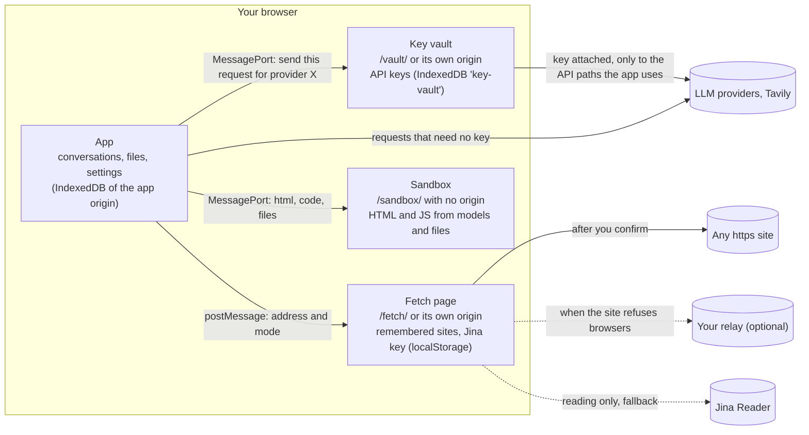

# Security

**English** | [日本語](security.ja.md)

How nobackend-llm-client protects your API keys, your conversations and your money: what the design is, what each part stops, and where it stops. It is for users who want to know what they can rely on, and for reviewers who want to check it against the code. The rules every change must keep are in [principles.md](principles.md) §2–§3; deployment steps are in the [README](../README.md).

## 1. What is protected, and from whom

**What is worth protecting**

- **API keys.** A leaked key spends your money and may expose your account.
- **Conversations and files.** Prompts, answers, attached and generated files, images, videos, saved prompts, skills.
- **Your money.** Requests that cost money (chat, images, videos, page reading) should happen only when you asked for them.

**Who or what the design defends against**

| Threat | Example |
|---|---|
| A script running in the app (XSS) | A bug in Markdown rendering or a dependency lets text from a model or a page run as script |
| Untrusted content steering the model (prompt injection) | A web page, search result, file or skill tells the model to send your data to an address |
| Code written by a model | HTML or JavaScript that a model writes and you run |
| Someone with your device or a copy of the browser profile | A shared or stolen computer, a profile backup |
| A leaked key | A key copied out of anywhere |
| A malicious backup or skill file | A file someone sends you to import |

**Out of scope** (see §4): a modified build served by whoever hosts the app, a compromised browser, extension or operating system, and what the providers do with your prompts.

## 2. Pages and origins

The app is four kinds of page. Each is a separate document with its own CSP, and each talks to the others only by messages.

The sandbox has no arrow out: its CSP blocks every request. The app never reaches arbitrary addresses or Jina Reader itself (`connect-src` in `appCsp`, `csp.config.ts`).

**Two deployments.** By default the vault and the fetch page are served from the app's own origin (`/vault/`, `/fetch/`). In the strict setup (README, "Strict setup") each has an origin of its own, and the app build leaves out its same-origin copies (`separateOrigins`, `csp.config.ts`). Several protections against XSS below hold only in the strict setup; they are marked **(strict setup only)**.

## 3. Design, and what each part prevents

### 3.1 No backend

Static files only. Your browser talks to each provider with your key; there is no server of ours in between, no account, no analytics, no third-party scripts. The one optional server is a fetch relay you deploy yourself (§3.6). Errors are kept in memory only for the diagnostics text (`src/lib/error-log.ts`).

*Prevents:* a server that collects prompts or keys; a breach of such a server.

### 3.2 The key vault

The vault page (`vault/`) is the only page that reads, stores, shows or sends API keys. The app opens it in a hidden frame and asks over a private `MessagePort` "send this request for provider X"; the vault attaches the key and streams the response back (`src/lib/vault/client.ts`, `vault/core.ts`). The app learns only whether a key is present, encrypted or locked (`status` in `vault/store.ts`), never its value. Keys are typed into the vault's own page, and so is the passphrase.

Before sending, the vault (`keyedFetch`, `refusal` in `vault/store.ts`):

- accepts only the providers built into this build and only the host fixed for each at build time (`src/lib/keys/accounts.ts`); providers cannot be added at runtime;
- accepts on that host only the API paths the app calls with the key: chat, the model list, and per provider its images, video, balance and key check (`paths` in `src/lib/providers/endpoints.ts` and `src/lib/tools/services.ts`). A provider added at build time (`VITE_CUSTOM_PROVIDERS`) gets only `chat/completions` and `models` under its base URL;
- compares the path decoded, segment by segment: a path with `..`, an encoded `/` or `\`, or an empty segment (`//`) matches none of them; the query string is not compared;
- accepts only `https` (plain `http` only for localhost) and no user name or password in the address;
- accepts only `GET` and `POST`, with a text body;
- removes any authentication headers the app sent (`Authorization`, `Cookie`, `x-api-key`, …) and sets only the provider's own key header;
- sends with `redirect: 'error'`, `credentials: 'omit'` and no referrer, so a redirect cannot carry the key to another host;
- passes back only a fixed list of response headers (`PASSTHROUGH_HEADERS`, `src/lib/vault/protocol.ts`).

The vault accepts a connection only from the app origins it was built for, never from `null` (sandboxed frames), and its `frame-ancestors` lists only those apps. It is built with no third-party packages and no framework; its DOM is made with `createElement` and `textContent`.

*Prevents:* a prompt or a script in the app sending a key to another host, or using it on the provider's other APIs (creating keys or managing the account, such as OpenRouter's `/api/v1/keys` or OpenAI's `/v1/organization/…`); the app's code, its Markdown rendering and its dependencies ever holding a key. **(strict setup only)** a script running in the app reading the keys. On the app's own origin, such a script can open the vault's storage or its frame directly, and read what is typed there.

*Does not prevent:* a script running in the app *using* the keys for what the app does with them. It can ask the vault for any chat, image or video request (`GET` or `POST`, with any body) and read the answer, spending up to what the key allows; use spend-limited keys (§5).

### 3.3 CSP, Trusted Types and sanitized Markdown

Every document gets a strict Content Security Policy, built in one place (`csp.config.ts`). It is sent as a header (`_headers`) and also written into the HTML as a `<meta>` tag for hosts that send no headers. The PDF worker gets its own, as a header only (it is served for `/assets/*`).

| Page | Scripts | Network (`connect-src`) | Other |
|---|---|---|---|
| App | `'self'` only, no inline | `'self'` and the providers it calls without a key | `img-src 'self' data: blob:`, `media-src blob:`, `form-action 'none'`, `frame-ancestors 'none'`, `webrtc 'block'`, Trusted Types |
| Key vault | `'self'` only | providers that take a key, and Tavily | `frame-ancestors`: the app; Trusted Types with no policy |
| Fetch page | `'self'` only | `https:` | `frame-ancestors`: the app; Trusted Types with no policy |
| Sandbox | inline and `eval` allowed | `'none'` | `frame-src 'none'`, `form-action 'none'`, `webrtc 'block'` |
| PDF worker | none loaded (`default-src 'none'`) | `'none'` | no `eval` or WebAssembly; Trusted Types with no policy |

Also on every response: `X-Content-Type-Options: nosniff`, `Referrer-Policy: no-referrer`, a `Permissions-Policy` that turns off camera, microphone, location, payment and USB; on the app, `Cross-Origin-Opener-Policy: same-origin`.

- **Trusted Types** (`require-trusted-types-for 'script'`): in browsers that enforce it, a string can become HTML or a script address only through three named policies: DOMPurify's, and two that each allow one fixed URL (the Service Worker in `src/main.tsx`, the PDF worker in `src/features/files/extract.ts`).
- **Markdown** (`src/lib/markdown/render.ts`): raw HTML in a model's answer is shown as text; links keep only `http(s)`, `mailto` and `#` and open in a new tab with `noopener noreferrer`; images from addresses are not loaded but shown as links; DOMPurify sanitizes with a short list of tags and attributes and returns DOM nodes, so no HTML string is parsed into the page.

*Prevents:* script injection in the first place; an answer that loads an image from `https://attacker/?data=…` (it is never fetched); scripts injected by the host (Cloudflare Web Analytics, Rocket Loader and the like are blocked, and the README says to turn them off).

### 3.4 Encryption at rest with a passphrase

Without a passphrase, keys and data are stored as they are. With one:

- **Keys** are encrypted in the vault with PBKDF2-SHA256 (600,000 iterations, 16-byte random salt) and AES-GCM-256 (`src/lib/crypto/passphrase.ts`). The passphrase must be at least 8 characters.
- **Data** is encrypted with a random 256-bit AES-GCM data key (`src/lib/crypto/data.ts`). The vault wraps that key with the passphrase and the app stores only the wrapped copy (`src/state/lock.ts`). The vault adds a marker to what it wraps and unwraps only blobs carrying it, so the app cannot have it decrypt anything else (`wrapDataKey`, `unwrapDataKey`).
- **What is encrypted:** conversations, messages, saved prompts, skills (except the name) and their files (path, type, size and bytes), files and their earlier versions, images, videos and their thumbnails, and the settings that hold your own text (the default instructions, and the image settings with image mode's last options) (`src/lib/db/sealed.ts`, `src/lib/db/repo.ts`). A field added later is encrypted unless it is listed as plain.
- **Unlocking** is per tab and per reload: each app page gives the vault its own random session id, and vault frames share the unlocked state only within one id (`vault/store.ts`). Until unlocked, the whole app is behind a lock screen, whose form is the vault's page.
- **Locking** (the sidebar button, or auto-lock after a chosen idle time; off by default) clears the vault's memory and reloads the app, which drops every decrypted value.
- **Showing a saved key** asks for the passphrase again even while unlocked (`revealKey`).
- **Passkey unlock** (optional, WebAuthn PRF, `vault/passkey.ts`): the passkey's PRF output, after user verification, goes through HKDF-SHA256 into an AES-GCM key that encrypts the passphrase. Changing or removing the passphrase removes the passkeys.
- **Forgotten passphrase:** nothing can be recovered; the only way on is to delete everything.

**What stays plain, even with a passphrase:**

- ids, creation and update times, the pinned flag of conversations, and the links between records (which message answers which, which file belongs to which conversation or skill);
- skill names;
- for images and videos: MIME type, size, time and conversation;
- the size of each encrypted record, which shows roughly how long each message is;
- the usage log: time, provider, model, kind of request, tokens, cost and conversation id of each request;
- other settings: language, theme, chosen and starred models, tool permissions, auto-lock time, web settings and the like;
- the background picture;
- the cached model lists;
- in the vault: which providers have a key and when it was saved, and the passkey records (credential id, salt, the encrypted passphrase);
- in the fetch page: the sites not asked about again and the Jina Reader key.

*Prevents:* someone with the device, the browser profile or a disk copy reading keys or conversations while the app is locked.

### 3.5 The sandbox

HTML and SVG files, runnable code blocks and the `run_javascript`, `run_skill_script` and `preview_page` tools run in `sandbox/sandbox.html`, framed with `sandbox="allow-scripts allow-forms"` (`src/lib/sandbox/client.ts`):

- **No origin.** It cannot reach the app's storage, the key vault or the page around it. It has no popups, no top navigation and no downloads.
- **No network.** Its CSP blocks every request (`connect-src 'none'`, `form-action 'none'`, `frame-src 'none'`); images and media come only from `data:` and `blob:`, fonts only from `data:`. The app's `frame-src` keeps the frame from navigating to another site.
- **Only when you ask.** Code from a model or a file runs when you press Run, open a page, or approve the tool. (File searches also run there, with the app's own code.)
- **Private port.** The sandbox page announces itself once; after that the app talks to it only over a `MessagePort`, and checks the shape of everything that arrives (logs as text, localStorage as an object of strings up to 1.5 million characters).
- **Only its own files.** A shown page gets only the files of its site (the nearest folder above it with an `index.html`).
- **Refuses to work with an origin.** Opened directly or framed without the sandbox attribute, the page does nothing.
- **Time limits.** Runs stop after 10 seconds; a shown page that stops answering for 5 seconds is removed.

*Prevents:* model-written code reading your data, reaching the vault, or sending anything out.

### 3.6 The fetch page, the relay and Jina Reader

Only the fetch page (`fetch/main.ts`) may reach any `https` address. Models use it through `fetch_url` (read a page) and `fetch_file` (save a file).

- It shows the full address and asks before each fetch. You can choose not to be asked again for a site, for reading and for saving apart; that list lives in the fetch page's own storage.
- **Addresses the model put together** (`src/lib/fetcher/provenance.ts`, `src/state/fetch-check.ts`). An address that came from outside the model is fetched as above: one in your messages, a search result, a link on a page fetched in the conversation (its links, at most 2,000, are kept with the tool result), or a library's file on jsDelivr, unpkg or cdnjs at an exact version. Addresses are compared normalized: scheme and host in lower case, no default port, percent-escapes normalized, no fragment. Any other address was put together by the model: the fetch page asks about it even on a site you chose not to be asked about, and marks its parts (host, path segments, query parameters) that no address seen on that site had.
- **Conversation text in such an address.** The app decodes the marked path segments and query parameters (percent-escapes, and long base64 or base64url tokens) and looks for a run of 8 or more characters (Unicode-normalized, case-folded) that also occurs in the conversation: the working folder's text files, attachments, earlier messages, tool results (pages read included), skills used, and the instructions. The words of your latest request do not count, so a site search built from them is not flagged. When found, the question says where (a file by its path, an earlier message, a tool result, the instructions), shows the text, and offers Cancel first. The check runs only for put-together addresses: about 0.1 s for 10 MB of text.
- The app sends what it found to the fetch page with the address, and the fetch page decides to ask. A script running in the app could leave it out: that is XSS (§4), not the prompt injection these checks are for.
- It shows nothing until the app that framed it proves who it is with a message from its origin, so another site cannot frame it to trick a click.
- **Redirects** (`fetch/redirect.ts`) are followed without asking only on the same site, or to a site you also chose not to be asked about; any other is asked about with its address. A browser hides where a direct fetch is redirected, so the relay is asked where it leads; without a relay, you are asked whether to follow it wherever it goes.
- It sends no cookies or referrer, takes only `https` addresses without a user name or password, and passes on at most 20 MB. The app does not keep SVG images.
- **Relay** (optional, `relay/worker.js`, on your own Cloudflare account): used only when a site refuses browsers, and to learn where a redirect leads. It takes only public `https` addresses, follows no redirect itself (it tells the fetch page where one leads), passes on none of your headers, keeps nothing, and answers only to the origins you list. It sees every address that goes through it.
- **Jina Reader** (`r.jina.ai`): used for reading only, when neither the site nor the relay works or the HTML holds almost no text. It sees the address, and your Jina key if you set one. The confirmation says so.

*Prevents:* a prompt-injected model sending data out inside an address without you seeing it, also on a site you chose not to be asked about. **(strict setup only)** a script running in the app using the fetch page to reach any address; on the app's own origin it can drive that page directly.

### 3.7 Tool approvals

Each tool is *ask*, *allow* or *deny* in Settings; a tool set to *deny* is not offered to the model at all. Defaults (`src/state/settings.ts`, tool definitions):

| Tool | Default | Notes |
|---|---|---|
| `web_search` (Tavily) | allow | the query goes to Tavily without asking: the one thing sent out without asking by default |
| `fetch_url`, `fetch_file` | confirmed in the fetch page | the app does not ask again; *deny* in settings still blocks them; "always allow" exists only in the fetch page, per site |
| `run_javascript`, `run_skill_script`, `preview_page`, `generate_image` | ask | `generate_image` costs money; saving the files a skill's script wrote is asked on its card every time, whatever the settings say |
| file tools | allow | only inside the conversation's working folder |
| `delete_file`, `save_skill` | ask every time | whatever the settings say, unless set to *deny* |
| `load_skill`, `read_skill_file` | allow | |

A reply may take at most 8 tool steps (`src/lib/chat/runner.ts`). Tool results, search results and attached or fetched files are marked as untrusted for the model, and the system prompt tells it never to follow instructions in them nor to put anything from the conversation into an address (`src/state/tool-registry.ts`).

*Prevents:* a mistaken or prompt-injected model acting without you. A model's file tools cannot name another conversation's folder.

### 3.8 A separate reader for fetched pages

`fetch_url` does not give the page to the conversation's model. A separate call with no tools gets the page's text and the model's request and answers it; only that answer reaches the conversation (`src/lib/chat/extract.ts`, `src/features/web/state.ts`). The reader is told the page is untrusted.

*Prevents:* instructions planted in a page calling tools. At worst they bend the reader's answer.

### 3.9 Skills

A skill's instructions go to the model as they are: a skill is trusted text. A skill is imported from a `SKILL.md`, a zip or a folder (`src/lib/skills/package.ts`), and nothing is saved before you have seen it: its `SKILL.md` and every file with its size, each text file readable, and, when it replaces a skill of the same name, the changes to the instructions and which files are added, changed or removed. Import keeps the name, description, body and whether models may load it on their own; other front matter keys (`allowed-tools` among them) are kept only as text written back when the skill is exported, and do nothing; a skill cannot unlock tools (`src/lib/skills/skill.ts`). A skill's files stay inside its folder: a path that leaves it (`..`, a leading `/`, a drive letter) refuses the whole skill, and so do more than 200 files, a file over 5 MiB, more than 20 MiB in all, or a zip entry that inflates past the size it gives, which is checked before anything is read (`src/lib/skills/files.ts`, `src/lib/zip.ts`). A model reads a skill's files with `read_skill_file` and runs its JavaScript with `run_skill_script`, both offered only in a conversation that loaded a skill with files. A script runs only when you approve it or have allowed it in Settings, in a sandbox worker of its own (§3.5) under a Node-like shim (`sandbox/node.js`): it gets copies, in memory, of its skill's files and of the working-folder files the model names, and writes only into that memory; it reaches nothing else of the app and no network, and runs only CommonJS JavaScript (no Python, shell or installed packages; libraries the app registers in `src/lib/sandbox/libraries.ts` are loaded by the app and handed over). What comes out is its exit code, what it printed (to the model and on its card) and the files it wrote: of those, only the text files you tick on the card are saved in the conversation's working folder, as `write_file` saves them (a replaced file keeps its earlier text). A model can create or change a skill only through `save_skill`, which asks every time and lets you read and edit the draft first.

### 3.10 Backups

- **No keys.** Backups never contain API keys or the data key (settings whose name starts with `secret` are left out, `src/lib/db/export.ts`).
- **Optional password.** A backup can be encrypted as a whole with its own password (`src/state/data.ts`): the key is derived as in the vault (PBKDF2-SHA256, AES-GCM-256), and the file is encrypted 4 MiB at a time, each chunk bound to its number and to whether it is the last, so chunks cannot be reordered, dropped or cut off (`encryptFile`, `src/lib/crypto/passphrase.ts`). This is on by default once a passphrase is set; otherwise a backup is plain JSON, or a zip of that JSON and the bytes of images, videos and skills' files. Opening one accepts only 100,000 to 2,000,000 PBKDF2 iterations (the file names its own count; a huge one would keep the tab busy).
- **Import checks every field.** It keeps only known fields of the expected types, drops system messages other than summaries, drops tool calls, drops skills that fail validation, adds a skill's files only to that skill and within a skill's limits (a path leaving its folder is dropped), imports no settings, and never overwrites an existing record.

*Prevents:* a backup leaking keys; an imported file changing your settings (such as where requests go), overwriting your data, or stalling the tab.

### 3.11 The Service Worker

`sw/sw.js` caches only the app's own static files, so it can start offline. It never touches requests to other origins or non-`GET` requests, and it leaves the fetch page and the sandbox alone. It serves two pages, network-first (from the cache only when the network fails), so an update applies on the next load: the app, and the vault when it is on the app's origin (the app waits for the vault before its first screen). A vault on its own origin is out of its reach. The previous release's files are kept until the next update, so a tab opened before an update can still load the parts it loads later.

*Prevents:* conversation content ending up in a cache.

### 3.12 One tab at a time

Only one tab uses the data at a time (Web Locks, `src/state/tab.ts`). Another tab waits until you choose to use the app there, and the first tab then stops. This keeps two tabs from writing over each other's changes; it is not a security boundary.

### 3.13 Limiting what a leaked key or a runaway costs

- The README tells you how to make a spend-limited key at each provider.
- Costs are shown as reported, estimates are marked as estimates.
- A reply's tool loop stops after 8 steps; a page using the experimental page API may call the model at most 20 times a minute.

## 4. Limits: what is not protected

- **The code you are served.** Whoever hosts the app (or controls the domain or the CDN) can serve different code at any time, and the next load uses it. There is no code signing and no published build. Builds are reproducible (README, "Check a build against its source"), so the files a site serves you can be compared with a build of source you have read, but only at the moment you compare. Run your own deployment from source you have read if this matters to you.
- **The default deployment and XSS.** With the vault and the fetch page on the app's origin (the default), a script running in the app could read your keys (when there is no passphrase or the vault is unlocked), read the passphrase as you type it, and fetch any address. Only the strict setup keeps the keys' values and arbitrary fetching out of its reach.
- **XSS even in the strict setup.** A script running in the app while it is unlocked can read your conversations and files, use your keys through the vault (§3.2), ask the vault to delete all keys, and show a fake lock screen to catch your passphrase. The CSP does not stop it from sending data out by navigating the tab or opening a window, nor through peer connections (WebRTC) in browsers that do not enforce the `webrtc` directive (Chrome). The design relies on preventing XSS in the first place (§3.3).
- **Your browser, extensions and operating system.** Anything that can read the page or your keyboard can read keys and conversations.
- **An unlocked app.** While unlocked, everything decrypted is in memory and on screen. Auto-lock is off unless you set it.
- **Providers see what you send.** Every prompt, file and image you send goes to the provider in plain text over HTTPS. Their logging and training policies apply (the README notes some).
- **Metadata seen by services.** Tavily sees your search queries; Jina Reader and your relay see the addresses they fetch; sites see your IP address when fetched directly; providers see your IP address and timing.
- **Prompt injection that convinces you.** Approval only helps if you read what you approve. A model can put your data into an address you then confirm, or into a link in its answer that you click.
- **What the address checks miss** (§3.6). They tell an address that appeared in the conversation from one the model put together, and look in the latter for text of the conversation as it is, percent-encoded or in base64. They miss text encoded another way (hex, a cipher, a translation or a summary), runs shorter than 8 characters (a PIN, a short number), text in a host name, data told by which address is fetched (a page listing one link per possible value for the model to choose from, or a choice among search results), data spread over several requests, and data in the path of a library's file on a CDN (the CDN sees it). A word of 8 or more characters from earlier in the conversation in a search the model builds is flagged too.
- **Sites you chose not to be asked about again.** An address on such a site that appeared in the conversation (a link on a page read, say) is fetched without asking; one the model put together is asked about. Its redirects to other sites are asked about, but Jina Reader fetches pages itself and follows their redirects: a page read through it can lead anywhere without asking.
- **Untrusted content still reaches models.** Marking content as untrusted, the separate reader and the system prompt reduce prompt injection; they do not remove it. A web search query is sent without asking by default.
- **Skills and backups you import.** A skill's body is followed as instructions; a conversation imported from a backup brings its own instructions (its system prompt). Import only files you trust.
- **Data kept plain** (§3.4): the usage log, settings, skill names, timestamps, record sizes, the background picture, and the fetch page's data, even with a passphrase.
- **Weak passphrases.** A copy of the browser profile can be attacked offline; PBKDF2 slows guessing but does not stop it for a short passphrase. A passkey makes unlocking as strong as the device's own unlock (PIN, fingerprint, face).
- **Hosts that cannot send headers** (GitHub Pages and the like): the `<meta>` CSP cannot carry `frame-ancestors`, so other sites can frame the pages (the vault and fetch page still accept messages only from the app), and `nosniff`, `Referrer-Policy` and COOP are lost. The PDF worker runs without its CSP (a `<meta>` CSP does not reach workers). Project sites under one `*.github.io` share one origin, so your other project sites can read what the app stores.
- **The sandbox.** DNS prefetch hints are asked off, which browsers do not guarantee; peer connections (WebRTC) are blocked only in browsers that enforce the CSP's `webrtc` directive (not Chrome). The sandbox removes them from its own window, but a frame created inside it has its own.
- **The relay** checks the `Origin` header, which any script outside a browser can fake, so others can use it within its rate limit, which Cloudflare applies loosely.
- **Browser storage can be cleared.** Browsers may delete site data when space is low, and Safari deletes data of sites not opened for 7 days. Ask for persistent storage in Settings → Privacy and data, and keep backups.
- **The experimental page API** (`VITE_EXPERIMENTAL_PAGE_API=1`): a page you show (possibly one a model wrote) can read and write its site's files, call the model (which costs money), and, with a relay, fetch https addresses, sending its site's files to any site you chose not to be asked about again. Never serve such a build to others.
- **No outside audit.** This design has not been reviewed by an independent security auditor.

## 5. Recommendations

**For users**

- Use **spend-limited keys** that can only make requests (for Venice, an INFERENCE key with a daily limit; see the README for each provider). Set a spending limit at the provider where it offers one.
- Never store an admin, management or provisioning key (such as an OpenRouter provisioning key or an OpenAI admin key). The vault sends a key only to the API paths the app uses, but in the same-origin setup a script running in the app can read the key itself and use whatever it is allowed to do (§3.2).
- Set a **passphrase** of several words, and an **auto-lock** time. Lock before leaving the device.
- **Encrypt backups** with a password, and keep them where only you can read them.
- **Read what you approve**: the address in the fetch page, the code or skill script before you run it, the files a script wrote before you save them, the skill draft before you save it.
- Allow a site without asking only if you trust it with anything the model might put in an address.
- Import skills and backups only from people you trust.
- Ask for **persistent storage** in Settings → Privacy and data.
- Prefer a deployment that uses the strict setup, run by someone you trust, or by yourself.

**For people who deploy it**

- Use the **strict setup**: the vault and the fetch page on origins of their own, as subdomains of one custom domain you control (README). Different `*.workers.dev` / `*.pages.dev` sites count as different sites, so the vault's storage may be partitioned.
- Use a **host that sends the headers** (Cloudflare Workers or Pages) and check that each page gets exactly one CSP (README, "Verify").
- Turn **off host features that inject scripts**: Web Analytics, Rocket Loader, Email Address Obfuscation, Zaraz.
- On a **custom domain, turn on HSTS** at the host. The app does not send it itself; `*.workers.dev` and `*.pages.dev` are under `.dev`, which browsers always load over HTTPS.
- Build from **source you have read**, pin it, and review dependency updates.
- Deploy the **relay** only if you need it, with `ALLOWED_ORIGINS` set to your fetch page's origin.
- Never serve a build with **`VITE_EXPERIMENTAL_PAGE_API`** to others.

## 6. Reporting a vulnerability, and disclaimer

Report a vulnerability privately with GitHub's private vulnerability reporting, not in a public issue: see [SECURITY.md](../SECURITY.md) for how, what to include and what to expect. The limits in §4 are known; a report that shows one is worse than described, or a way around a protection in §3, is in scope.

The software is provided "as is", without warranty of any kind, under the MIT License ([LICENSE](../LICENSE)). This document describes the design; it is not a guarantee that the design holds. You are responsible for your API keys, the costs of your requests, and what you send to providers. This project is not affiliated with or endorsed by any of the providers or services it works with.
